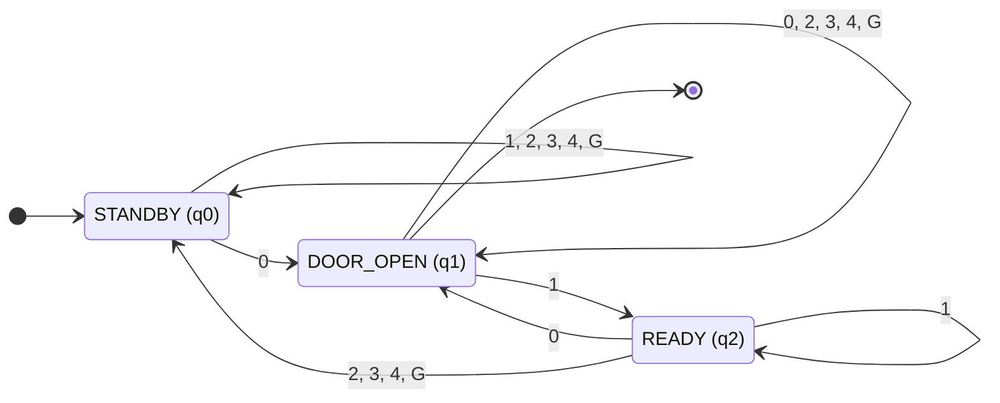

# Elevator Control System: DFA Simulator

An interactive website that models an elevator as a **deterministic finite automaton (DFA)**. It has 4 floors (G, 2, 3, 4), one start state and one final state. It is built with plain HTML, CSS and JavaScript, with no libraries and no backend.

**Author:** Joreese Clyde R. Manginsay


## Run it locally

1. Download or clone the repository.
2. Keep `index.html`, `style.css` and `script.js` in the same folder.
3. Open `index.html` in any modern browser.

```bash
git clone https://github.com/joreese-clyde/elevator-automata.git/
cd elevator-automata
# then open index.html in your browser
```

## The DFA

**M = (Q, Σ, δ, q₀, F)**

- **Q = {q0, q1, q2}**
- **Σ = {0, 1, 2, 3, 4, G}**
- **δ** is the transition function, shown in the state table below
- **q₀ = q0**: the start state, because the elevator begins parked at the ground floor with the doors closed
- **F = {q1}**: a string is accepted if it ends with the doors open at a stopped floor

### States

| State | Name | Meaning |
|---|---|---|
| q0 | STANDBY | Doors closed, waiting for a request. The door must be opened first before going to any floor |
| q1 | DOOR_OPEN | Stopped with the doors open |
| q2 | READY | Doors closed after boarding, waiting for a floor to be selected |

### Alphabet

| Symbol | Meaning |
|---|---|
| 0 | The door will open |
| 1 | The door will close |
| 2 | Floor 2 is requested |
| 3 | Floor 3 is requested |
| 4 | Floor 4 is requested |
| G | The ground floor is requested |

### State table δ

| δ | 0 | 1 | 2 | 3 | 4 | G |
|---|---|---|---|---|---|---|
| → q0 (STANDBY) | q1 | q0 | q0 | q0 | q0 | q0 |
| \* q1 (DOOR_OPEN) | q1 | q2 | q1 | q1 | q1 | q1 |
| q2 (READY) | q1 | q2 | q0 | q0 | q0 | q0 |

→ marks the start state and \* marks the final state.

### State diagram



The arrow from `[*]` marks the start state (q0). The arrow into `[*]` marks the final state (q1).

## The door-first rule

To go to any floor, the door must be opened first:

1. Press **0** to open the door.
2. Press **1** to close it.
3. Press a floor (**G, 2, 3 or 4**). The car moves only from READY (q2).
4. After arriving, the system returns to STANDBY (q0) and waits for the door to open again.

A floor symbol in q0 or q1 is ignored (self-loop). Opening an open door, or closing a closed door, is also a self-loop.

## Example strings

**Accepted** (end in q1, the doors open)

| String | Path | What happens |
|---|---|---|
| `0` | q0 → q1 | Door opens at G |
| `0120` | q0 → q1 → q2 → q0 → q1 | Goes to floor 2, door opens |
| `0130` | q0 → q1 → q2 → q0 → q1 | Goes to floor 3, door opens |
| `0140` | q0 → q1 → q2 → q0 → q1 | Goes to floor 4, door opens |
| `0120130` | q0 → q1 → q2 → q0 → q1 → q2 → q0 → q1 | Floor 2, then floor 3 |
| `01401G0` | q0 → q1 → q2 → q0 → q1 → q2 → q0 → q1 | Floor 4, then back to G |

**Rejected**

| String | Ends in | Reason |
|---|---|---|
| (empty) | q0 | Nothing was pressed |
| `1` | q0 | Closing a closed door does nothing |
| `3` | q0 | Floor key ignored, door not opened first |
| `01` | q2 | Door closed, waiting for a floor |
| `013` | q0 | Arrived at floor 3, but the door never opened |
| `0134` | q0 | Arrived at floor 3, then 4 is ignored in q0 |
| `01301` | q2 | Opened at floor 3, then closed again |

## Features

- Animated elevator with a floor display, ▲/▼ direction arrow and door animation
- Buttons for open door, close door and floors G, 2, 3, 4
- Hint that tells you the next step in the door-first rule
- Live state diagram that highlights the current state and the transition just taken
- Transition table that highlights the current row and the cell just used
- Input string, accepted or rejected result, and an event log
- "Run a string" box that plays any string such as `0130` step by step
- Reset and clear log buttons

## Files

| File | Purpose |
|---|---|
| `index.html` | Page structure |
| `style.css` | Styling and layout |
| `script.js` | DFA logic, diagram, table and UI |

## Demo tip

Press **3** first and notice that nothing happens (self-loop in q0). Then press **0**, **1**, **3**, **0** and watch the state diagram and table update. The string `0130` is accepted.

## Simplifications

- One request at a time, with no request queue
- No weight or fault sensors
- The current floor is tracked outside the DFA, so the car moves instantly between states and the animation is only visual
- Moving between floors is not a separate state

## License

See the [LICENSE](LICENSE) file.